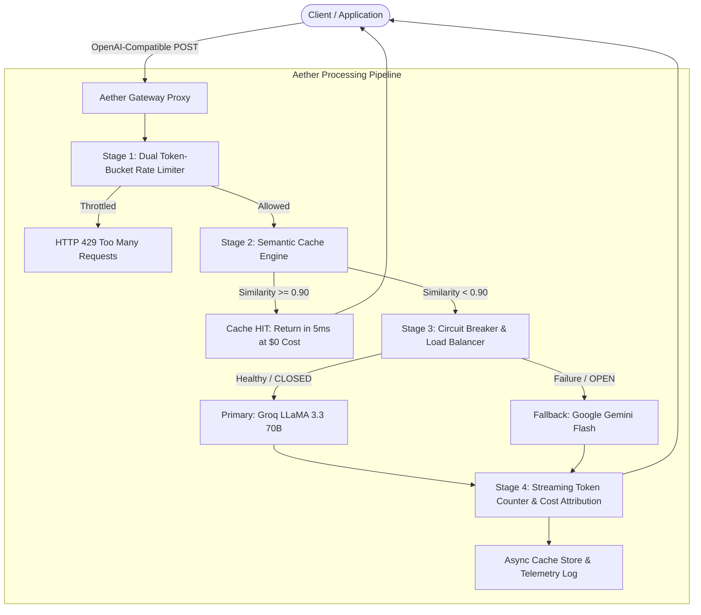

# ⚡ Aether-Gateway
### High-Concurrency AI Reverse Proxy & Semantic Caching Gateway

> An enterprise-grade, high-performance reverse proxy designed to sit between client applications and downstream LLM providers (Groq, Google Gemini, OpenAI). It delivers sub-10ms semantic cache responses, atomic dual token-bucket rate limiting, automatic circuit breaker failovers, and streaming token cost attribution.


[](https://www.linkedin.com/in/ankur-pal-2b2ba9433)

---

## 🏗️ System Architecture



---

## 🚀 Key Features

* **Dual-Dimension Token-Bucket Rate Limiter (Stage 1)**: Simultaneously tracks and throttles both **RPM (Requests Per Minute)** and **TPM (Tokens Per Minute)** using an atomic, microsecond-fast continuous time-delta refill algorithm.
* **Semantic Vector Cache (Upcoming Stage 2)**: Replaces strict string-matching caches with dense cosine similarity vector search (`all-MiniLM-L6-v2`), serving recurring semantic queries in under **10ms** at **$0 cost**.
* **Circuit Breaker Fault-Tolerance (Upcoming Stage 3)**: Automatic 3-state finite state machine (`CLOSED` -> `OPEN` -> `HALF_OPEN`) that prevents cascading failures and instantly routes traffic away from failing or rate-limited providers.
* **Universal OpenAI Drop-in Compatibility**: Fully compliant with the standard `/v1/chat/completions` API specification.

---

## 🛠️ Project Structure

```
Aether-Gateway/
├── config.py                      # Pydantic Settings & Twelve-Factor configuration
├── core/
│   ├── __init__.py
│   └── rate_limiter.py            # Stage 1: Dual Token-Bucket Engine (RPM & TPM)
├── demo_stage1_ratelimiter.py     # Stage 1 interactive benchmark & verification script
├── requirements.txt               # Production dependencies
├── .env.example                   # Environment configuration template
└── README.md
```

---

## ⚡ Quickstart & Stage 1 Verification

### 1. Clone & Install
```bash
git clone https://github.com/FresherMen/Aether-Gateway.git
cd Aether-Gateway
pip install -r requirements.txt
```

### 2. Configure Environment
```bash
cp .env.example .env
# Add your GROQ_API_KEY and GEMINI_API_KEY
```

### 3. Run Stage 1 Rate Limiter Benchmark
```bash
python3 demo_stage1_ratelimiter.py
```

**Benchmark Output Preview:**
```
======================================================================
🚀 AETHER-GATEWAY: STAGE 1 (TOKEN-BUCKET RATE LIMITER) BENCHMARK
======================================================================
--- TEST 1: Rapid Burst Test (Sending 6 requests instantly) ---
Request #1: ✅ ALLOWED | Remaining Req: 4/5 | Retry-After: 0.00s
Request #2: ✅ ALLOWED | Remaining Req: 3/5 | Retry-After: 0.00s
Request #3: ✅ ALLOWED | Remaining Req: 2/5 | Retry-After: 0.00s
Request #4: ✅ ALLOWED | Remaining Req: 1/5 | Retry-After: 0.00s
Request #5: ✅ ALLOWED | Remaining Req: 0/5 | Retry-After: 0.00s
Request #6: 🛑 THROTTLED (HTTP 429) | Remaining Req: 0/5 | Retry-After: 12.00s
   ↳ Generated HTTP Headers: {
       'X-RateLimit-Limit-Requests': '5',
       'X-RateLimit-Remaining-Requests': '0',
       'X-RateLimit-Limit-Tokens': '500',
       'X-RateLimit-Remaining-Tokens': '250',
       'Retry-After': '12.00'
     }
```

---

## 📄 License
MIT License. Built by [Ankur Pal](https://github.com/FresherMen).
