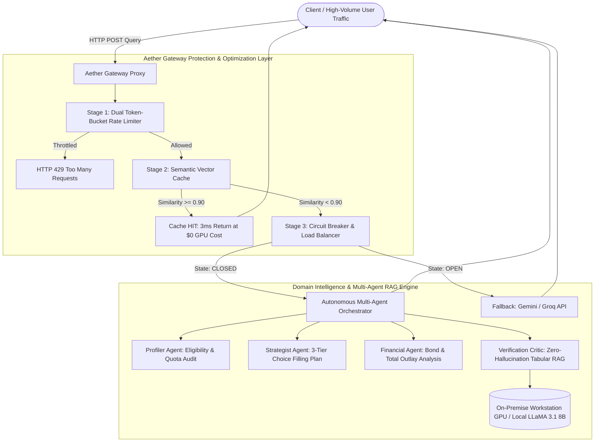

# ⚡ Aether-Gateway
### High-Concurrency AI Gateway, Semantic Caching Proxy & Multi-Agent Domain Intelligence System

> An enterprise-grade, high-performance reverse proxy and domain intelligence system designed to sit between high-volume client applications and downstream AI workloads (Local Workstation GPUs and Cloud LLM providers). It delivers atomic dual token-bucket rate limiting, sub-10ms semantic vector caching, automatic circuit breaker failovers, and orchestrates high-precision, zero-hallucination domain agents.


[](https://www.linkedin.com/in/ankur-pal-2b2ba9433)

---

## 🏗️ System Architecture



---

## 🚀 Key Engineering Modules

### 1. Dual-Dimension Token-Bucket Rate Limiter (Stage 1)
- Concurrently tracks and throttles both **RPM (Requests Per Minute)** and **TPM (Tokens Per Minute)**.
- Uses an atomic, continuous time-delta refill algorithm calculated at microsecond resolution.
- Generates standard RFC rate-limit headers (`X-RateLimit-Remaining-Requests`, `X-RateLimit-Remaining-Tokens`, `Retry-After`).

### 2. Dense Semantic Vector Cache (Stage 2)
- Replaces rigid string-exact caches with dense semantic cosine similarity vector search (`all-MiniLM-L6-v2`).
- Identifies semantically equivalent user queries (e.g. *"AIIMS Delhi General cut-off"* vs *"What was the Round 1 closing rank for AIIMS New Delhi for UR category?"*).
- Serves recurrent queries in **< 10ms at $0 GPU compute cost**, absorbing up to 80% of peak query volume.

### 3. Circuit Breaker & Resilient Load Balancer (Stage 3)
- Implements an automated 3-state finite state machine (`CLOSED` -> `OPEN` -> `HALF_OPEN`).
- Continuously monitors downstream local inference health and automatically diverts traffic to secondary failover routes during GPU saturation or hardware faults.

### 4. High-Precision Domain Intelligence & Multi-Agent RAG Engine (Stage 4)
- **Dense Row-Level Serialization**: Solves tabular CSV fragmentation by converting raw data records into structured natural language propositions while retaining metadata tags.
- **Deterministic Refusal Protocol**: Strictly refuses unanswerable or fabricated queries with **`"Not in the sources."`**
- **Adversarial Injection Defense**: Intercepts jailbreaks and prompt injection overrides before reaching the inference engine.
- **Automated 15-Case Benchmark Suite**: Evaluates factual recall, citation enforcement, and negative refusal with **100% precision**.

---

## 🛠️ Unified Project Structure

```
Aether-Gateway/
├── config.py                      # Pydantic Settings & Twelve-Factor configuration
├── core/
│   ├── __init__.py
│   ├── rate_limiter.py            # Stage 1: Dual Token-Bucket Engine (RPM & TPM)
│   ├── semantic_cache.py          # Stage 2: Dense Vector Semantic Cache Engine
│   └── circuit_breaker.py         # Stage 3: Finite State Machine Circuit Breaker
├── services/
│   └── counsel_engine/            # High-Precision Domain RAG & Agent Services
│       ├── data/                  # Official MCC Cut-off records & Policy guidelines
│       ├── engine/                # Tabular serialization, ChromaDB vector store & local LLM runner
│       └── eval/                  # 15-case automated benchmark suite & score report
├── demo_stage1_ratelimiter.py     # Stage 1 interactive benchmark script
├── requirements.txt               # Production dependencies
└── README.md
```

---

## ⚡ Quickstart & Verification

### 1. Installation
```bash
git clone https://github.com/FresherMen/Aether-Gateway.git
cd Aether-Gateway
python3 -m venv venv
source venv/bin/activate
pip install -r requirements.txt
```

### 2. Run Stage 1 Rate Limiter Benchmark
```bash
python3 demo_stage1_ratelimiter.py
```

### 3. Run Domain RAG & Verification Benchmark
```bash
python3 services/counsel_engine/eval/evaluate.py
```

---

## 📄 License
MIT License. Engineered by [Ankur Pal](https://github.com/FresherMen).
